# Windgets

Desktop widgets for Windows 11: hardware telemetry and small everyday tools,
each in its own frameless window that you can place anywhere — on a second
monitor, for instance — and leave there.

Every widget is a module. A disabled widget is not loaded at all: no window,
no background work.

## Widgets

<table>
  <tr>
    <th>GPT Design</th>
    <th>Claude Design</th>
  </tr>
  <tr>
    <td><a href="assets/screenshots/overview-gpt.webp">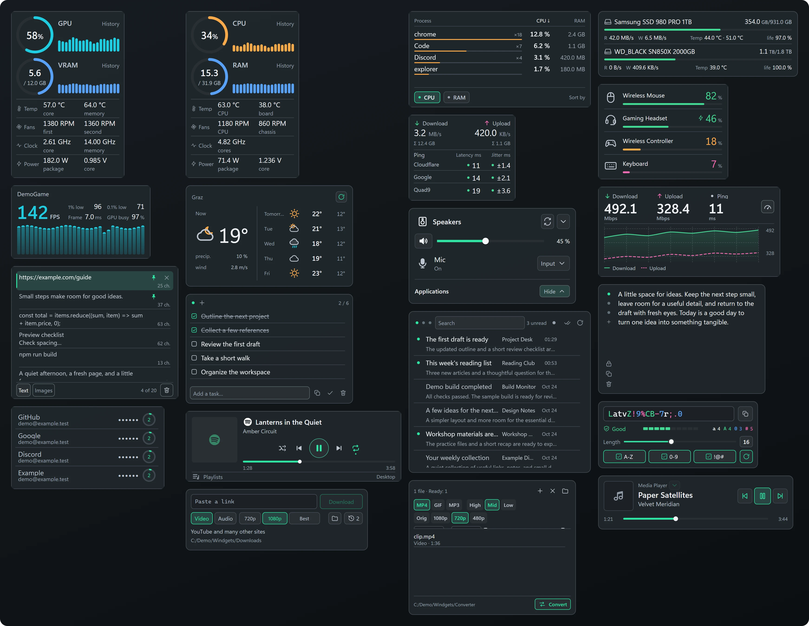</a></td>
    <td><a href="assets/screenshots/overview-claude.webp">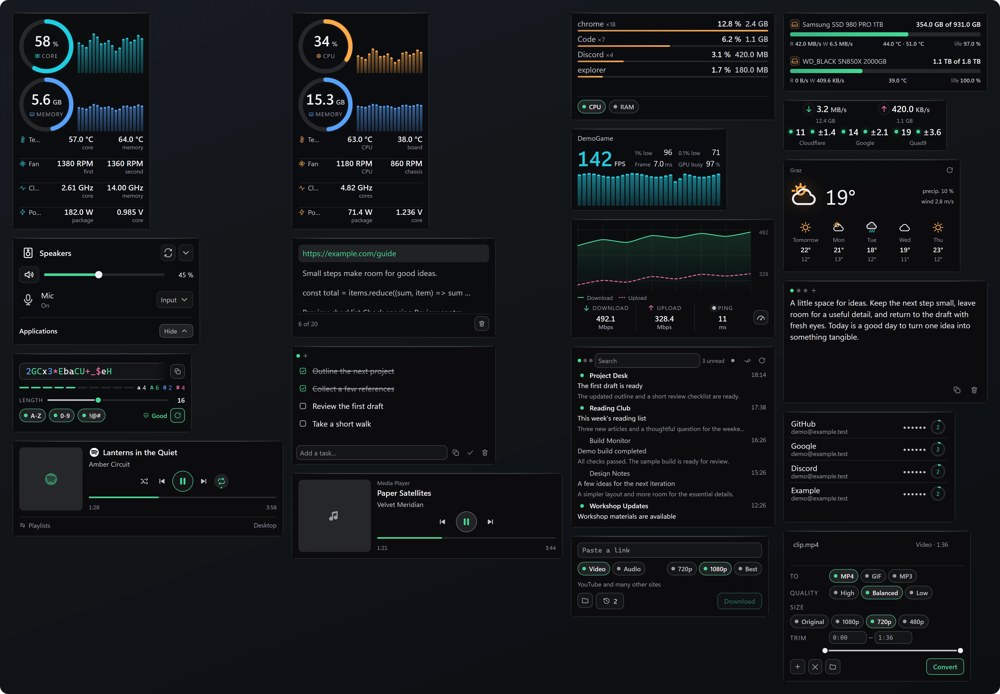</a></td>
  </tr>
</table>

- **Hardware** — CPU with RAM, GPU with VRAM, drives: load history, temperatures,
  fans, clocks, power. Sensors are matched by role, so the cards adapt to the
  hardware they run on and hide what your machine does not have.
- **Network** — download and upload speed plus ping to three targets.
- **Processes** — top processes by CPU or memory.
- **Battery** — charge of mice, keyboards, headsets and gamepads: Bluetooth via
  Windows, Logitech devices via HID++, headsets via HeadsetControl.
- **Frame counter** — FPS, 1% low and frame time of the game in front, via
  Intel PresentMon (reads ETW, injects nothing into the game).
- **Speedtest** — on demand, via Measurement Lab (NDT7).
- **Weather** — Open-Meteo, no account or key needed.
- **Sound** — output devices and a per-app volume mixer.
- **Spotify** — a remote control for the Spotify app (Premium required).
- **Media** — whatever Windows is playing right now.
- **Mail** — IMAP inbox, up to five mailboxes.
- **2FA codes** — TOTP, secrets encrypted with Windows DPAPI.
- **Notes**, **To-do**, **Password generator**.
- **Clipboard history** — text and images, with pinned entries; memory only.
- **Converter** — files to MP4, GIF, MP3, PNG or JPG via ffmpeg.
- **Downloader** — video or audio by link via yt-dlp.

The interface is available in English, Russian, Ukrainian, Spanish and Chinese.

<p align="center">
  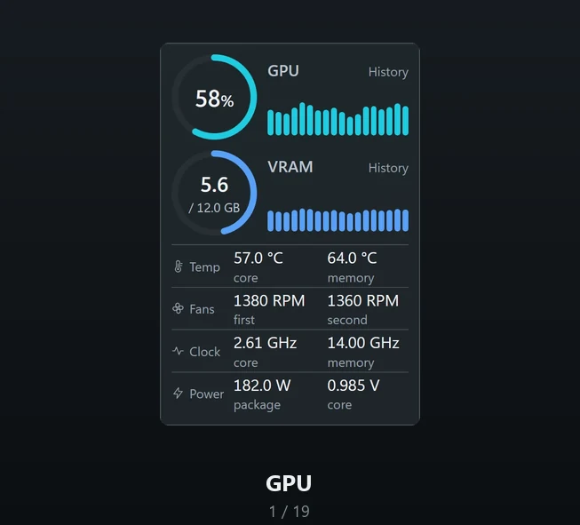
</p>

<details>
<summary>Every widget up close</summary>

<table>
  <tr>
    <td align="center">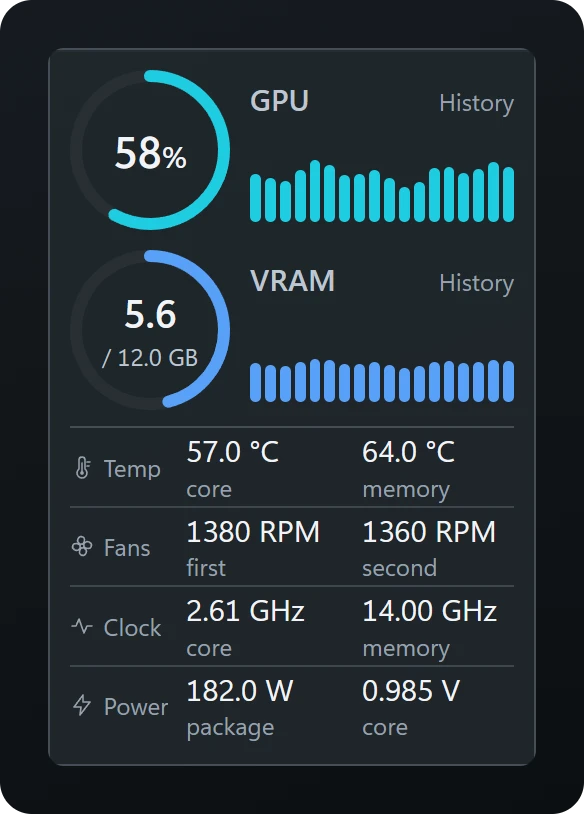<br>GPU</td>
    <td align="center">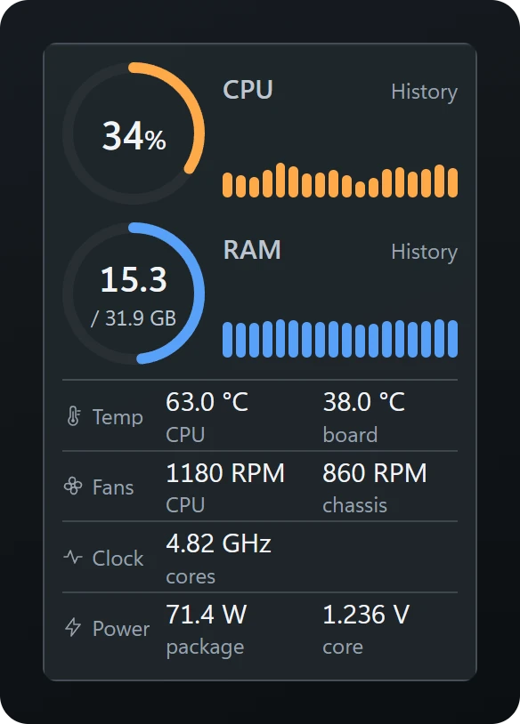<br>CPU and RAM</td>
    <td align="center">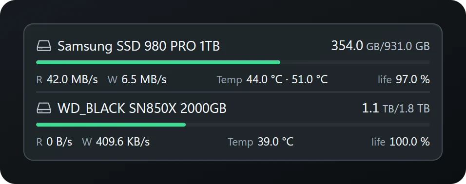<br>Drives</td>
  </tr>
  <tr>
    <td align="center">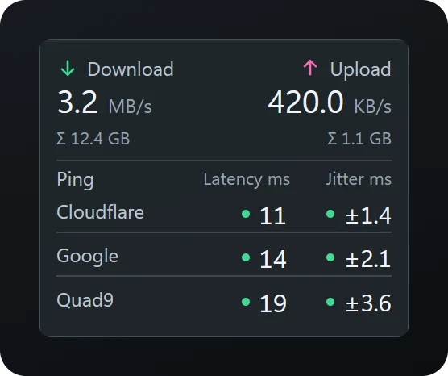<br>Network</td>
    <td align="center">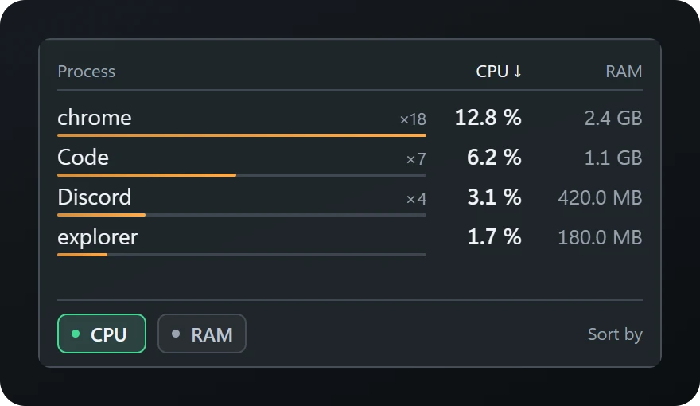<br>Processes</td>
    <td align="center">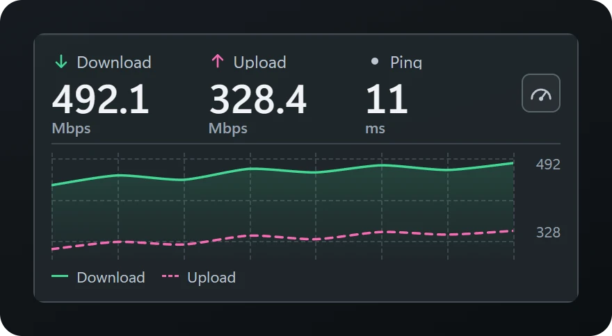<br>Speedtest</td>
  </tr>
  <tr>
    <td align="center">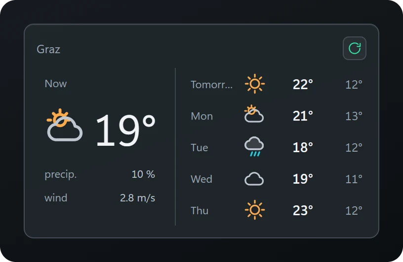<br>Weather</td>
    <td align="center">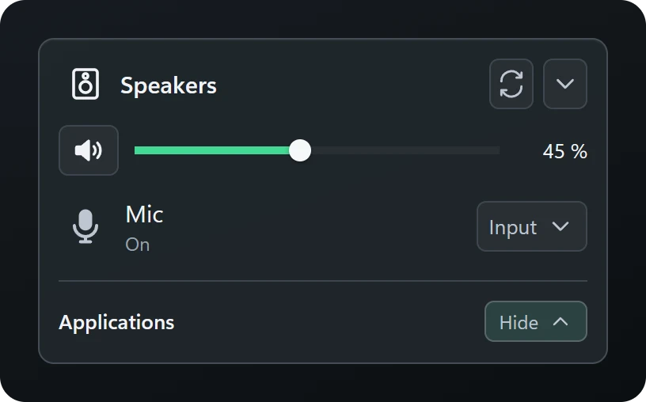<br>Sound</td>
    <td align="center">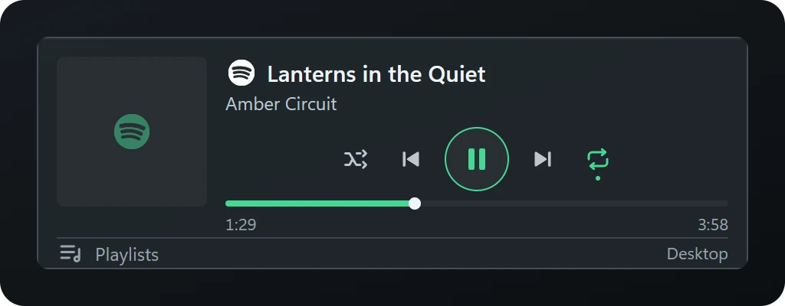<br>Spotify</td>
  </tr>
  <tr>
    <td align="center">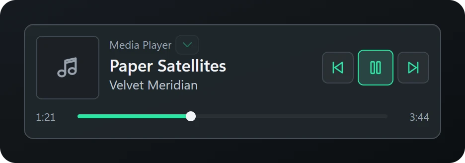<br>Media</td>
    <td align="center">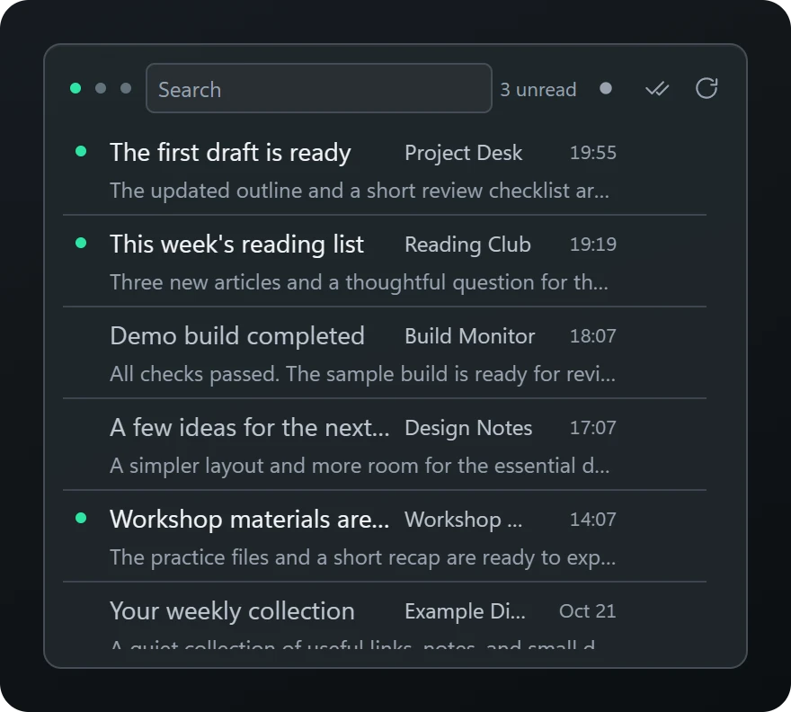<br>Mail</td>
    <td align="center">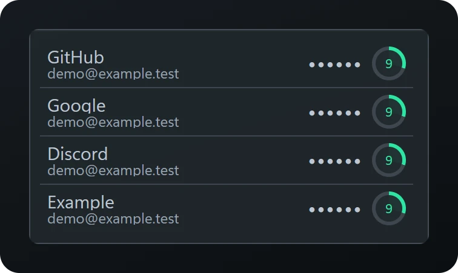<br>2FA codes</td>
  </tr>
  <tr>
    <td align="center">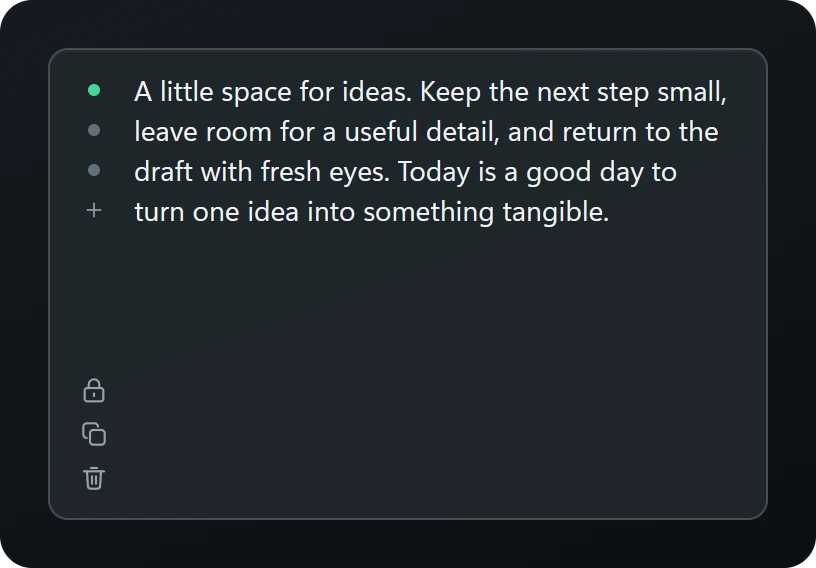<br>Notes</td>
    <td align="center">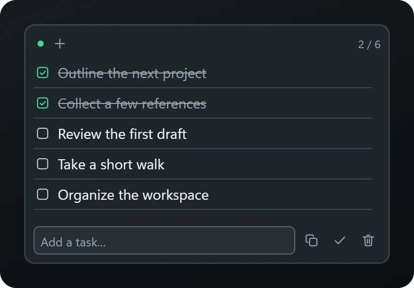<br>To-do</td>
    <td align="center">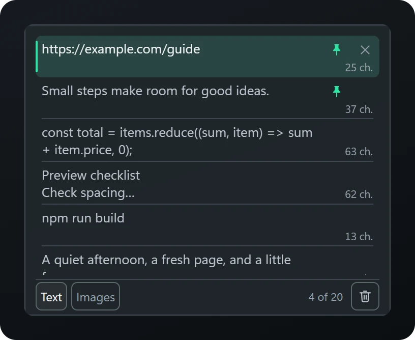<br>Clipboard history</td>
  </tr>
  <tr>
    <td align="center">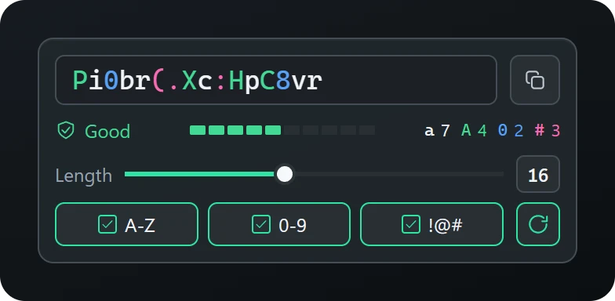<br>Password generator</td>
    <td align="center">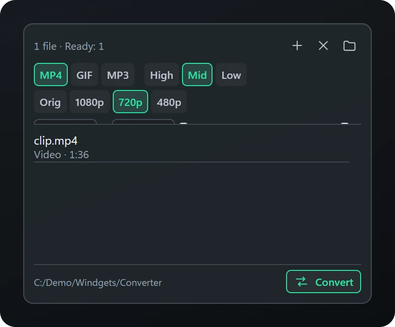<br>Converter</td>
    <td align="center">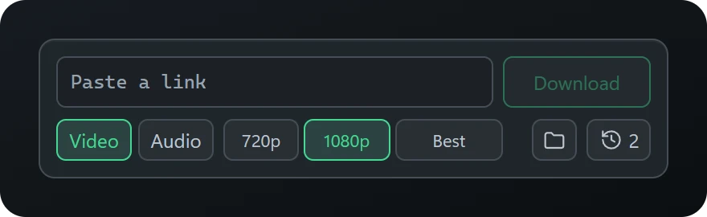<br>Downloader</td>
  </tr>
  <tr>
    <td align="center">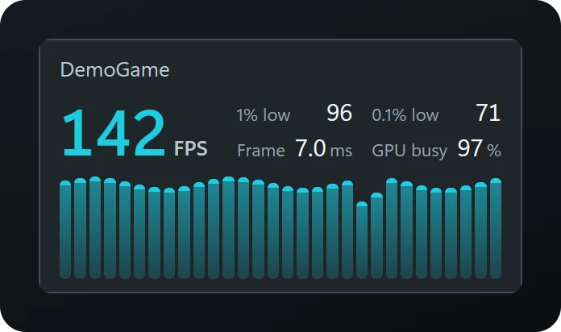<br>Frame counter</td>
    <td align="center">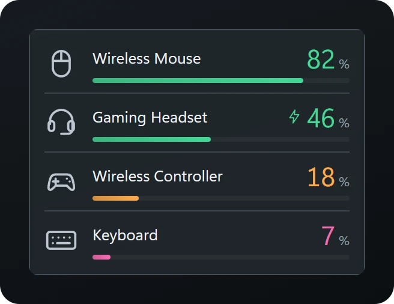<br>Battery</td>
  </tr>
</table>

</details>

## Requirements

- Windows 11.
- **Administrator rights.** The app asks for them on start. Without them most
  CPU, motherboard and drive sensors cannot be read at all (MSR, Super I/O and
  SMART need elevated access); this is a hardware limitation, not a choice.
- **PawnIO driver** for CPU and motherboard sensors. It is not bundled: the CPU
  card offers to install it from its official GitHub release, with SHA-256
  verification, only after you agree.
- ffmpeg, yt-dlp, QuickJS, PresentMon and HeadsetControl are not bundled
  either. The converter, the downloader, the frame counter and the battery
  widget fetch them from the authors' official GitHub releases when you
  ask, verify SHA-256 and can remove them with one button. An ffmpeg already
  on `PATH` is used as is.

## Privacy

In short:

- **No analytics, no metrics, no telemetry.** The app does not count, track or
  report anything about you or how you use it.
- **No ads, no purchases, no accounts.** Nothing to sign up for, nothing to
  buy inside the app.
- **No server of its own.** The author receives no data from the app at all.
- **Your data stays on your computer**, in
  `%APPDATA%\io.github.commonfool.windgets`. Mail passwords and 2FA secrets are
  encrypted for your Windows user; clipboard history is never written to disk.
- **The app goes online only for widgets you turn on**, and only to the
  service that widget needs:
  - Weather — Open-Meteo (the city you chose);
  - Network — ping to Cloudflare, Google and OpenDNS;
  - Speedtest — Measurement Lab, only when you press the button (M-Lab
    publishes test results, including your IP address, as open data);
  - Spotify — Spotify, with your own sign-in;
  - Mail — your own mail server;
  - Updates and optional tools — GitHub. The update check runs once a week
    and can be turned off in Settings → General.

Full details are in the [Privacy Policy](PRIVACY.md).

## Building from source

You need Node.js 22+, Rust (stable, MSVC toolchain), the .NET SDK (the sensor
sidecar targets .NET Framework 4.7.2) and the
[Tauri prerequisites](https://tauri.app/start/prerequisites/) for Windows.

```
npm install
npm run tauri dev      # from an elevated terminal
npm run tauri build    # installer in src-tauri/target/release/bundle
```

`npm run app` does the same as `tauri dev` and asks for elevation itself.

Sensor data comes from a small C# sidecar (`src-sensors/`) built on
[LibreHardwareMonitorLib](https://github.com/LibreHardwareMonitor/LibreHardwareMonitor).

## Download and code signing

Installers are published on the
[Releases](https://github.com/Common-Fool/WindGets/releases) page and built
by GitHub Actions from this repository.

### "Windows protected your PC"

The installer is not code-signed yet, so on first run Windows shows two
warnings. Both are expected:

- **SmartScreen: "Windows protected your PC".** Click **More info**, then
  **Run anyway**. SmartScreen warns about any program that has no paid
  signing certificate and few downloads yet — it says nothing about what the
  program does.
- **User Account Control: "Unknown publisher".** Click **Yes**. The app needs
  administrator rights to read hardware sensors (see Requirements); without a
  certificate Windows cannot show a publisher name.

Why trust it anyway:

- The code is open — it is this repository.
- Installers are built by GitHub Actions from this repository, not on someone's
  computer; the build log is public on the
  [Actions](https://github.com/Common-Fool/WindGets/actions) page.
- Each release lists the SHA-256 of the installer. To compare, run in
  PowerShell: `Get-FileHash .\Windgets_*_x64-setup.exe`.

## Made with AI

Windgets is written with the help of AI coding assistants —
[Claude Code](https://claude.com/claude-code) by Anthropic and
[Codex](https://openai.com/codex) by OpenAI. The ideas, design decisions,
review and testing on real hardware are the author's; the assistants write
most of the code under that direction. Public commits list them as
co-authors.

## Support

Windgets is free and will stay free. If it is useful to you:

- [Ko-fi](https://ko-fi.com/commonfool)
- [Monobank jar](https://send.monobank.ua/jar/6m4nBQCW9B)
- [Crypto via NOWPayments](https://nowpayments.io/donation/commonfool)

## License

MIT — see [LICENSE](LICENSE). Third-party components and their licenses are
listed in [THIRD-PARTY-NOTICES.txt](THIRD-PARTY-NOTICES.txt).
